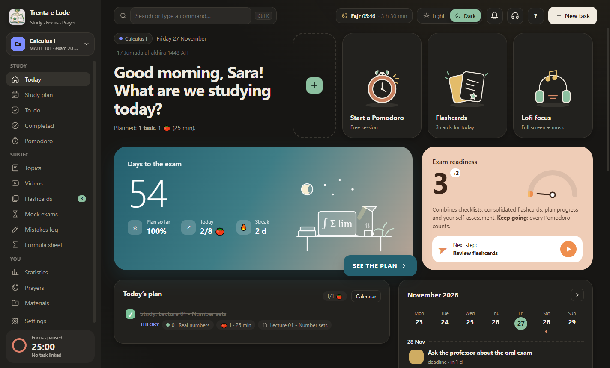
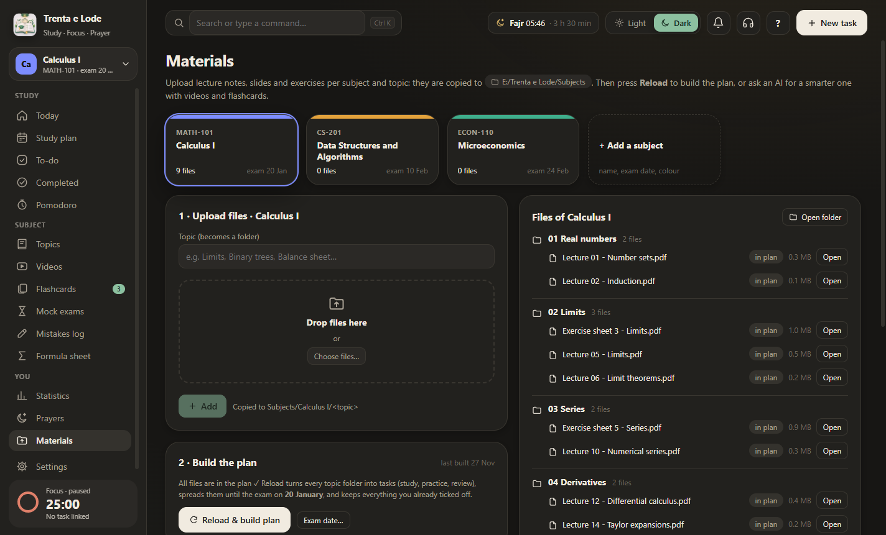
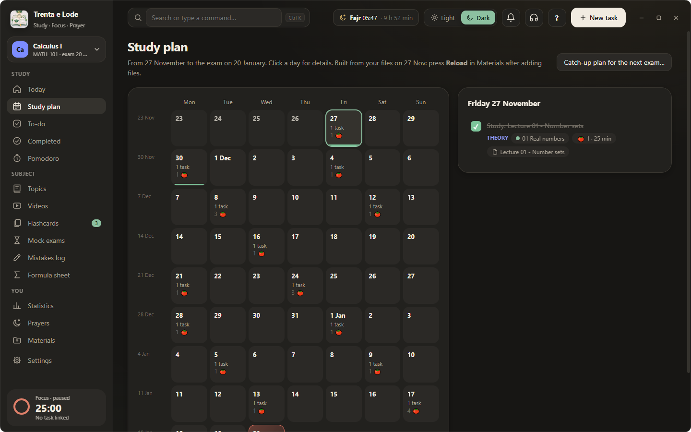
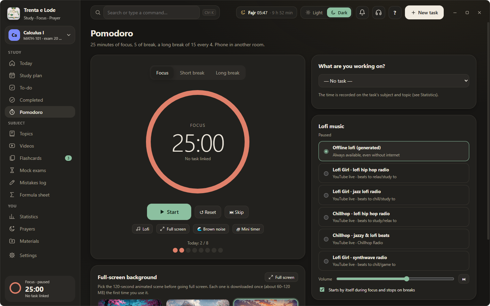
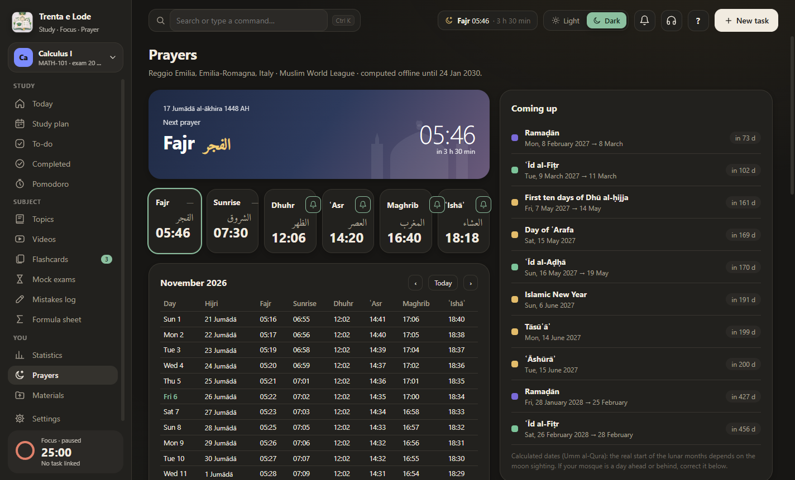
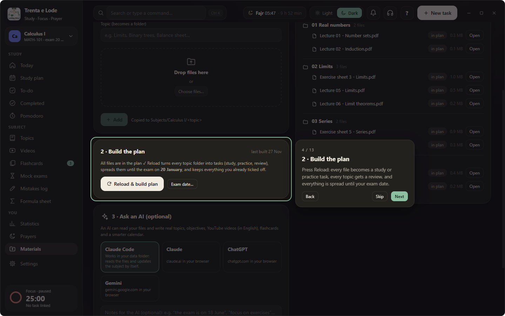

<p align="center"></p>

<h1 align="center">Trenta e Lode</h1>

<p align="center"><b>A free, open-source study planner for university students.</b><br>
Your subjects · a study plan built from your own files · Pomodoro with a lofi focus mode · flashcards and mock exams · prayer times for any city.</p>

<p align="center"><a href="../../releases/latest"><b>⬇ Download for Windows</b></a> · <a href="#build-from-source">Build from source</a> · MIT license</p>

> *Trenta e lode* ("thirty with honours") is the top grade at Italian universities. This app grew out of one student's exam preparation and is now free for everyone.



## What it does

- **Your own subjects.** The app starts empty. Add the subjects you are studying, with an optional exam date and colour, and switch between them from the sidebar.
- **A plan built from your files.** In **Materials**, upload lecture notes, slides and exercises, one folder per topic. Press **Reload** and every file becomes a study or practice task, every topic gets a review, and the last days before the exam get a mock exam and a final review. Tasks are spread until the exam date, respecting a daily goal across all subjects (lighter Sundays). Ticked tasks keep their day; everything else is re-planned.
- **Ask an AI, any AI.** For a smarter plan, one click prepares a request for **Claude Code**, **Claude**, **ChatGPT** or **Gemini**: it writes real topics, learning objectives, exam-style questions, YouTube lectures and flashcards. Claude Code works directly in your data folder; for the web assistants you attach the files, paste the prompt, and paste the JSON answer back. Every YouTube ID is verified before it is added, and nothing you already have is deleted.
- **Study tools.** Today dashboard with exam countdown and readiness, calendar, to-do list with natural-language input (`redo exercise 7 tomorrow !! #limits 2🍅`), a **Completed** list of everything you ticked off, topics with checklists, flashcards with spaced repetition, a formula sheet, timed mock exams with self-grading, a mistakes log, and statistics.
- **Pomodoro with lofi.** Offline generated lofi music or Lofi Girl / Chillhop live radios. Radios are stored by name, not by link: the app always finds the stream that is live now and switches to another one if a stream ends.
- **Full-screen focus mode.** Pick one of six animated 120-second scenes (downloaded once), or, with a radio selected, let the live stream itself fill the screen. When the window is minimised, a small dynamic "notch" keeps the timer at the top of the screen.
- **Prayer times anywhere (optional).** Choose your city: prayer times are computed on your computer for three years ahead (12 calculation methods, Shafiʿi or Hanafi ʿAsr), with the Hijri calendar, Ramaḍān and ʿĪd styling, prayer popups (never for Fajr), and gentle morning/evening adhkar and short Qur'an passages every few minutes. Everything can be turned off.
- **Cross off days.** Double right-click a day in the *Study plan* calendar to cross it out with an X (do it again to remove it).
- **Motivating sounds.** Soft sounds when you hover buttons and tabs; a tick that climbs in pitch as today's plan fills up; a fanfare when every task of the day is done, and bigger ones for the daily Pomodoro goal, finishing today's flashcards, catching up on overdue tasks and completing a whole phase. All synthesised offline; turn them off in Settings → *Interface sounds*.
- **Light and dark themes**, a guided tutorial, and a first-run setup wizard.
- **A tidy window.** On Windows the app has no title bar: rounded corners with its own minimise, maximise and close buttons (drag it by the top bar). On large screens (3440×1440 and up) it opens at 1730×1100. On Windows and macOS it can start when you sign in (Settings).

| | |
|---|---|
|  |  |
|  |  |
|  |  |

## Install

1. Download `Trenta-e-Lode-Setup-x.y.z.exe` (installer) or `Trenta-e-Lode-x.y.z-portable.exe` from the [latest release](../../releases/latest).
2. Windows may show "Windows protected your PC" because the app is not code-signed: click **More info → Run anyway**.
3. The setup wizard asks for your name (optional), your subjects and, if you want them, your city for prayer times. A short tour then shows you around; replay it any time with the **?** button.

## How to use it

1. **Add a subject** (sidebar → *Add a subject*): name, optional code, exam date and colour.
2. **Materials → Upload files**: type a topic (it becomes a folder) and drop the files. Repeat for each topic.
3. **Reload & build plan**: tasks appear in *Today*, *Study plan* and the calendar.
4. **Optional, ask an AI**: pick Claude Code, Claude, ChatGPT or Gemini and press *Ask*. With the web assistants, attach the files from the folder that opens, paste the prompt (Ctrl V), then paste the answer in *Paste the AI's answer* and press **Import**.
5. Study with the **Pomodoro** (link a task so the time is counted), tick tasks off, and review them in **Completed**.

Your files live in the data folder (default `Documents\Trenta e Lode`):

```
Trenta e Lode/
├─ Subjects/<subject>/<topic>/…      your files (+ subject.json written by an AI)
├─ Requests/                          prompts prepared for the AI assistants
├─ Offline/                           prayer table, adhkar and Qur'an passages
├─ Media/                             focus-mode backgrounds
└─ CLAUDE.md                          instructions for Claude Code
```

The `subject.json` format is documented in [`src/data/AI-GUIDE.md`](src/data/AI-GUIDE.md).

## Privacy

Everything stays on your computer: there is no account and no analytics. The app only goes online to search your city (Open-Meteo), download the adhkar and Qur'an passages once, download the background videos from this repository's releases, play YouTube videos and radios, and check YouTube IDs suggested by an AI. Nothing is sent to an AI by the app itself: you choose what to paste or attach.

## Build from source

Requires [Node.js](https://nodejs.org/) 20 or later.

```bash
git clone https://github.com/mada-droid/trenta-e-lode.git
cd trenta-e-lode
npm install
npm start          # run the app
npm run dist       # build the Windows installer and portable exe into dist/
```

`npm run dist:mac` and `npm run dist:linux` build for macOS and Linux (run them on those systems). The app is plain JavaScript with no build step: the main process is `main.js`, the interface is in `src/` (`src/js/*.js` share one global scope; every page is a function returning HTML).

The source of the animated backgrounds (Remotion) is in [`video-loops/`](video-loops/).

## Credits

See [THIRD-PARTY-NOTICES.md](THIRD-PARTY-NOTICES.md): Electron, KaTeX, adhan-js, the Amiri fonts, duasrevival.com for the adhkar, quran.com for the Qur'an text and translation, Open-Meteo for the city search.

## License

[MIT](LICENSE): free to use, change and share.
